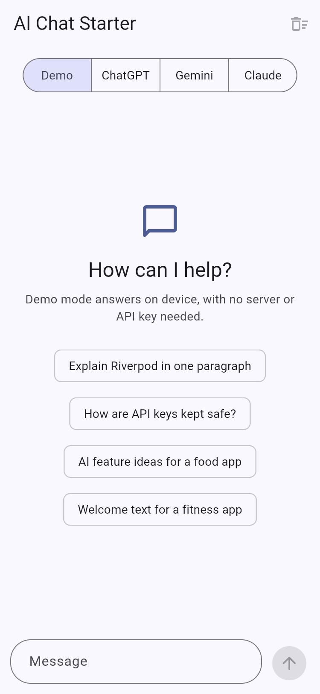
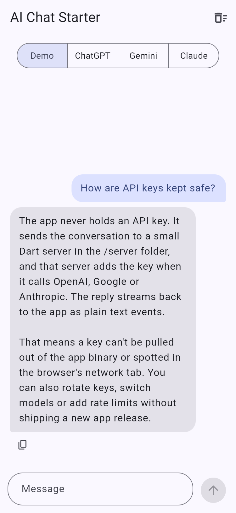
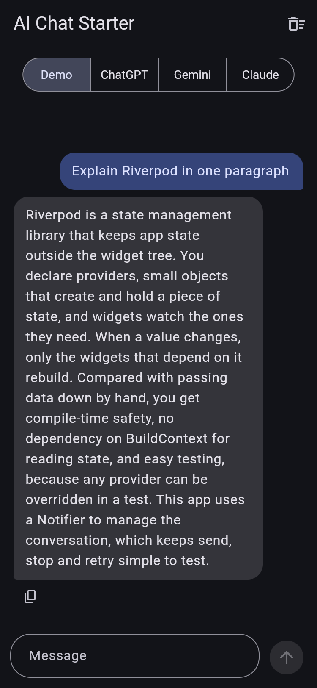
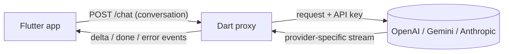

# AI Chat Starter for Flutter

A Flutter chat app that streams answers from ChatGPT, Gemini and Claude, with the API keys kept safely on a small Dart server instead of inside the app.

Demo mode needs no server and no keys, so you can clone the repo, run it and watch a reply stream in. When you want real answers, start the proxy in `server/`, add a key and pick a provider at the top of the screen.

## Screenshots

| Demo mode | Finished reply | Dark theme |
| --- | --- | --- |
|  |  |  |

## Features

- Replies stream in as they are generated, with a typing indicator until the first words arrive.
- ChatGPT, Gemini and Claude behind one selector; you can switch between them mid-conversation.
- Demo mode answers on device, for first runs, UI work and screenshots.
- Stop a reply and keep what arrived, retry a failed one, copy an answer or clear the chat.
- Enter sends when a hardware keyboard is attached (web, tablets); Shift+Enter adds a new line.
- Plain-language errors for the usual problems: server not running, bad key, rate limits, dropped connections.
- Light and dark themes, and a layout that stays readable from phones to wide browser windows.
- Tests for the parser, HTTP client, controller and main UI flows, plus offline tests for each provider adapter on the server.

## Why the API key stays on the server

Anything shipped inside a mobile or web app can be extracted. A key in a Flutter build can be pulled from the binary in minutes, and on the web it is visible in the browser's network tab. Once it leaks, anyone can run up your bill.

This starter never gives the app a key. The app sends the conversation to the proxy, the proxy adds the key and calls the provider, and the reply streams back. That also means you can rotate keys, change models or tighten rate limits without shipping an app update.

## How it works



Each provider streams in its own format. The proxy turns all three into the same three events, so the app needs only one small parser. Adding a fourth provider touches the server in four places: a new adapter in `server/lib/src/providers/` (exported from `server/lib/chat_proxy.dart`), its key and model in `server/lib/src/config.dart`, an entry in the `providers` map in `server/bin/server.dart`, and its display name in `_providerNames` in `server/lib/src/router.dart`. The app needs one new `AiProvider` enum value; its networking and parsing code stay the same.

### Streaming contract

`POST {CHAT_API_URL}/chat`

```json
{
  "provider": "openai | gemini | claude",
  "messages": [
    { "role": "user", "content": "Hello" },
    { "role": "assistant", "content": "Hi! How can I help?" },
    { "role": "user", "content": "Explain Riverpod" }
  ],
  "system": "Optional system prompt"
}
```

`system` replaces the server's `SYSTEM_PROMPT` unless the proxy runs with `ALLOW_CLIENT_SYSTEM_PROMPT=false`. Requests are capped at 256 KB and 100 messages.

The response is `text/event-stream`. Each event is one `data:` line followed by a blank line:

```text
data: {"type":"delta","text":"Riverpod is"}

data: {"type":"delta","text":" a state management library"}

data: {"type":"done"}
```

If something fails, the stream ends with `{"type":"error","message":"..."}` instead of `done`. The message is written for end users and never contains provider error bodies. While a model is thinking, the proxy also sends `: keep-alive` comment lines so idle connections are not dropped; SSE clients ignore them.

`GET {CHAT_API_URL}/health` returns `{"status":"ok","providers":["openai","claude"]}`, listing only the providers that have a key.

## Project structure

```text
assets/icon/                       Launcher icon sources for flutter_launcher_icons
lib/
  main.dart
  app.dart                         MaterialApp and light/dark themes
  core/
    config.dart                    CHAT_API_URL from --dart-define
  features/chat/
    data/
      ai_provider.dart             Demo, ChatGPT, Gemini, Claude
      chat_message.dart            Immutable message model and status
      chat_repository.dart         Interface the controller depends on
      proxy_chat_repository.dart   Streaming HTTP client for the proxy
      demo_chat_repository.dart    On-device canned replies
      sse_parser.dart              Pure SSE parsing, easy to unit test
      chat_exception.dart          Error with a message safe to show users
    application/
      chat_controller.dart         Riverpod Notifier: send, stop, retry, clear
    presentation/
      chat_screen.dart
      widgets/                     Bubbles, input, provider picker, typing dots, empty state
test/                              Parser, client, controller and widget tests
server/
  bin/server.dart                  Entry point and provider wiring
  lib/src/
    router.dart                    Routes, CORS and the event stream
    chat_request.dart              Request validation
    config.dart                    Environment and .env loading
    sse.dart                       Event encoding and upstream parsing
    providers/                     OpenAI, Gemini and Claude adapters
  test/                            Sample-stream tests, no network needed
  Dockerfile
```

## Quick start

You need Flutter 3.47 or newer (tested on Flutter 3.47.8 stable, Dart 3.13).

### 1. Run the app in Demo mode

```bash
flutter pub get
flutter run
```

Demo mode is selected by default and needs no server. Tap a suggested prompt to see a streamed reply.

### 2. Start the proxy

```bash
cd server
cp .env.example .env    # add at least one API key
dart pub get
dart run bin/server.dart
```

You should see `Providers enabled: ...` in the log. The proxy accepts connections from your whole network, so a phone on the same Wi-Fi can reach it; [server/README.md](server/README.md) explains what that means for your keys and lists every setting.

### 3. Point the app at the proxy

The app looks for the proxy at `http://localhost:8080` by default, which works for web and the iOS simulator. Pick ChatGPT, Gemini or Claude at the top of the screen and start chatting.

For anything else, pass the URL at build time:

```bash
# Android emulator (10.0.2.2 is the host machine)
flutter run --dart-define=CHAT_API_URL=http://10.0.2.2:8080

# Physical device on the same Wi-Fi
flutter run --dart-define=CHAT_API_URL=http://192.168.1.20:8080

# Deployed proxy
flutter run --dart-define=CHAT_API_URL=https://chat-proxy.example.com
```

Platform notes:

- The project ships with Android, iOS and web targets. The Android INTERNET permission is already set, so release builds can reach the proxy.
- Desktop targets are not included. Add them with `flutter create --platforms=windows,macos,linux .`; macOS also needs the `com.apple.security.network.client` entitlement in `macos/Runner/*.entitlements` to reach the proxy.
- Android debug builds allow plain `http://` so you can test against a local proxy; release builds only allow HTTPS. On iOS, use HTTPS or add an App Transport Security exception for local testing.
- Production builds should always use an `https://` proxy URL.

## Testing

```bash
# Flutter app
flutter analyze
flutter test

# Proxy server
cd server
dart analyze
dart test
```

None of the tests touch the network or need API keys. The provider tests replay sample streams in each API's format, delivered in small chunks so the parsers are tested against split lines just like real network traffic.

## Tech stack

Flutter (Material 3), Riverpod 3, package:http, and a Dart server built on shelf and shelf_router, with server-sent events end to end. The proxy talks to the OpenAI Chat Completions API, Gemini's `streamGenerateContent` and the Anthropic Messages API.

## Roadmap

- Chat history saved on device, with multiple conversations
- User sign-in and per-user rate limits on the proxy
- Markdown and code block rendering
- Retrieval (RAG) over your own documents
- Voice input and spoken replies
- Image input for multimodal models

## Built by Oriental Tech Solutions

This starter is maintained by [Oriental Tech Solutions](https://github.com/OrientalTechSolutions), a Flutter studio in Lahore, Pakistan, founded by Attaullah Hazarvi. We have been building mobile apps for 13+ years and now focus on iOS and Android apps with AI features built in.

If you want a chat assistant, an AI feature or a complete Flutter app built on the same foundations, we would be glad to help.

**Hire us on Upwork:** https://www.upwork.com/freelancers/attaullahhazarvi

## License

Released under the [MIT License](LICENSE).
